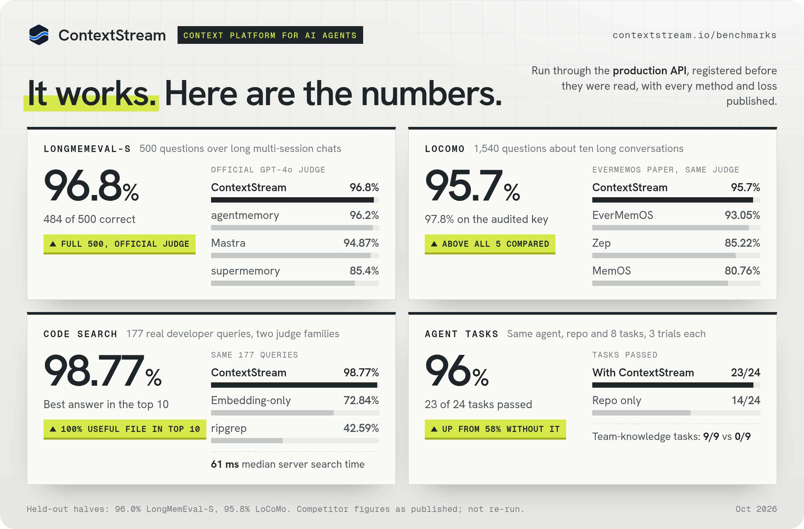

<!-- mcp-name: io.github.contextstream/mcp-server -->

<p align="center">
  
</p>

<h1 align="center">ContextStream MCP Server</h1>

<p align="center"><strong>The context platform for AI agents.</strong></p>

## Your agent knows code. Give it the decisions behind yours.

Connect your code, docs, and conversations so your agents can find the right
files, recall saved decisions, and build on past work across sessions and tools.

<a href="https://contextstream.io/benchmarks">
  <picture>
    <source media="(prefers-color-scheme: dark)" srcset="https://raw.githubusercontent.com/contextstream/mcp-server/main/assets/benchmarks-dark.png">
    
  </picture>
</a>

The numbers, their sources, and what they do not claim are under [Benchmarks](#benchmarks).

<a id="install-in-30-seconds"></a>

## Start free with MCP

**10,000 monthly credits. No credit card required.**

Works with Claude Code, Cursor, Codex, GitHub Copilot, Gemini CLI, Qwen Code,
Kimi Code, Muse Code, ZCode, Zed, and [more MCP clients](docs/clients.md), on
Claude, GPT, Gemini, Kimi, GLM, Qwen, and other models.
Create your account or sign in during MCP onboarding. No separate website signup needed.

**macOS and Linux**

```sh
curl -fsSL https://contextstream.io/scripts/mcp.sh | bash
```

**Windows PowerShell**

```powershell
irm https://contextstream.io/scripts/mcp.ps1 | iex
```

Paste the command into your terminal and follow onboarding to connect your
project and supported editor. Restart your editor after setup.

[What gets installed and indexed?](docs/data-handling.md) ·
[Supported clients](docs/clients.md) ·
[Setup guide](https://contextstream.io/docs/editors/setup) ·
[Prefer to start on the web?](https://contextstream.io/lp/mcp-marketplace?utm_source=github&utm_medium=directory&utm_campaign=mcp_organic_2026q3&utm_content=card_cta)

## Make the next session useful

Ask your connected agent:

> Use ContextStream to find the files relevant to my next change. Cite the
> sources and retrieve any saved project decisions that should guide the work.

Then ask it to save a real decision and its reason. Start a new session and
retrieve that decision without explaining it again. Indexing supplies code
context; it cannot recover every undocumented decision.

## Give any AI app the project: Live Capsule

Ask your agent to "make a live capsule". One `capsule(action="live")` call
returns:

- a **live link** (`/c/<token>/live`) to paste into ChatGPT or Claude: small,
  current pages about the file tree, files, symbols, decisions, lessons, plans
  and docs, which the chat reads by following links;
- an **MCP link** (`/c/<token>/mcp`) to add once as a custom connector in
  Claude, ChatGPT, Gemini, Cursor or any MCP app. The app shows it as
  "Live Capsule". It needs no sign-in, because the link is its own key.

By default a link shows no file contents and no personal items, and it expires
after 7 days. Including code or personal items, or a longer expiry (up to 30
days), happens only when you ask for it. You can revoke a link at any time.
When someone pastes a live link, the agent reads it with
`capsule(action="live_read")`.

Use `capsule(action="create", review=...)` in a local MCP session to make a
Review Capsule from Git changes with secret redaction. Capsules and handoffs
can show the verification state of the indexed tree.

## Check your changes

Turn on remote checks with `contextstream-mcp remote-checks on` or
`session(action="remote_checks", enabled=true)`. In a local MCP session,
`check` runs supported tests, lints, type checks and builds on a worker using
a snapshot of your checkout. From a shell, use `contextstream-mcp run -- <command>`.
If the worker declines the check, `run` runs the command on your machine.
[Supported toolchains](https://machinestream.io/docs/support).

- **Run the checks your edit needs.** Use `verify` (also callable as
  `ms_verify`) in a local MCP session. It uses the project's dependency and test
  graph to choose checks. It widens the run for changes such as lockfiles,
  migrations, auth code, shared fixtures or configuration, and when the graph
  finds broad impact or cannot map the changes to tests. Ask for `scope="full"`
  to run the full detected suite before completing a task. Checks run remotely
  when available, with a local fallback, and stop at the first failure. To
  choose checks by directory, open **Verification Map** in the workspace's
  **Capsules** panel. The next targeted plan uses the most specific matching
  rules alongside the graph's checks. The panel flags stale rules.
- **Check more commands in one run.** Supported `&&` chains use one checkout
  upload and stop on the first failure. The MCP reports stages as they run
  when the client supplies a progress token. Try
  `npx prisma generate && npx tsc --noEmit`,
  `npx next typegen && npx tsc --noEmit` or
  `npx svelte-kit sync && npx svelte-check`. Checks also cover tools such as
  `tsgo`, Oxlint, Oxfmt in check mode, `vue-tsc --noEmit`, `astro check`,
  `ty check`, Pyrefly, Basedpyright, `cargo fmt --check` and `go tool staticcheck`.
  Run Prettier with `--check`, `-c`, `--list-different` or `-l` through
  `npx`, `pnpm exec`, `yarn exec`, `npm exec` or the project's
  `node_modules/.bin`. Use the project's pinned Prettier version. The worker
  declines write flags such as `--write` and `-w`.
- **See what broke.** When base-tree results are available, failure diagnostics
  put new failures ahead of existing ones. The report can cite a matching
  lesson, decision or commit.
- **Check consumers of a shared contract.** After a successful remote
  `check` from a local MCP session, ContextStream can check indexed consumers
  in the same workspace. It applies eligible changed contract files to each
  reachable consumer's default branch in the worker and returns compiler
  errors with your result. The worker needs the consumer's default-branch
  tree from a previous check. A consumer whose change cannot be applied is
  reported as unverified.
- **Prepare before the first check.** Supported local editor hooks can send a
  free `:prepare` call in the background to set up the worker's checkout and
  dependencies. A busy worker or failed preparation leaves the next check to
  start as usual. Remote checks can report up to 32 local tool versions.
  They use `go version` for Go and try `java --version` followed by
  `java -version` for Java.
- **Check saves in the background.** Speculative checks are off until you
  opt in. With remote checks enabled, set `CONTEXTSTREAM_SPECULATIVE_CHECKS=on`
  for the editor hooks, or set `speculative_checks` with `enabled` in
  `PUT /api/v1/mcp/hosted-tools/enabled` for your account. After a supported
  edit and a pause, the hook can run up to three checks. A matching cached
  result costs no credits. The hosted service defaults to 100 speculative
  credits per account per hour in addition to the client's limits below.
  Explicit checks can still run when the speculative budget is spent.
- **Require a passing receipt.** Workspace owners and admins can set a gate
  for pushes, pull-request creation or completion through
  `GET` and `PUT /api/v1/mcp/hosted-tools/gate-policy`. Gates start off.
  Set `required_command_families` to require specific checks. An enabled
  gate names what is missing when the exact Git tree lacks a fresh passing
  receipt. Git's managed `pre-push` hook checks the trees being pushed,
  including from a terminal. Setup installs the hook where Git capture
  is enabled. [How the hooks apply gates](docs/clients.md#remote-checks-and-verification-hooks).

### Remote check environment variables

Set these in the environment of the local MCP process, editor hooks or shell
that runs the check.

| Variable | Default | What it controls |
|---|---|---|
| `CONTEXTSTREAM_HOSTED_TOOLS` | Unset, so available hosted tools can be used | `off` disables hosted check execution, command routing, background preparation, speculative checks and local receipt gates. |
| `CONTEXTSTREAM_CONTRACT_CHECK` | On | `off` skips the consumer check. |
| `CONTEXTSTREAM_SPECULATIVE_CHECKS` | Follows the account setting, which starts off | `on` opts in locally when `check` is available. `off` overrides the account setting. |
| `CONTEXTSTREAM_SPECULATIVE_DEBOUNCE_MS` | `3000` | Milliseconds to wait after a supported edit. `0` removes the wait. |
| `CONTEXTSTREAM_SPECULATIVE_HOURLY_CAP` | `30` | Local speculative credits per hour across repositories for the configured credential and API. `0` stops background execution. |
| `CONTEXTSTREAM_SPECULATIVE_REPO_HOURLY_CAP` | `15` | Local speculative credits per repository per hour. `0` stops background execution. |
| `CONTEXTSTREAM_CHECKOUT_SNAPSHOT` | Allowed when a local call needs a snapshot | `off` disables checkout snapshots for hosted checks, speculative checks and `:prepare`. |
| `CONTEXTSTREAM_CHECKOUT_SNAPSHOT_REPOS` | All repositories eligible | Limit snapshots to repositories whose origin URL or checkout folder name starts with a listed prefix. Use commas or spaces between prefixes. |
| `CONTEXTSTREAM_HOSTED_ENV` | On | `off` omits the streamed environment description and tool-version probes. |
| `CONTEXTSTREAM_HOOK_ENABLED` | On for installed editor hooks | `off` disables editor hook activity, including automatic preparation, speculative checks and editor-side gates. Git hooks have separate controls. |
| `CONTEXTSTREAM_SESSION_INIT_ENABLED` | On | `false` disables the session-start hook, including its `:prepare` trigger. |
| `CONTEXTSTREAM_POSTWRITE_ENABLED` | On | `false` disables the post-write indexing path and its `:prepare` trigger. Speculative scheduling happens before this switch is read. |
| `CONTEXTSTREAM_GIT_CAPTURE` | Follows the repository setting, then the global default | `off` stops Git event capture and skips managed hook installation. An already installed `pre-push` hook can still check receipts. |
| `CONTEXTSTREAM_GIT_CAPTURE_DEFAULT` | On | Sets the fallback for Git capture when the repository and `CONTEXTSTREAM_GIT_CAPTURE` leave it unset. |
| `CONTEXTSTREAM_CAPSULE_ENABLED` | On for regular sessions | `off` hides the capsule tool in those sessions, including Review Capsule creation. |
| `CONTEXTSTREAM_HTTP_LOCAL_FILES` | Off for HTTP connections | `allow` is a self-hosted gateway setting for access to the gateway's own filesystem. Use a local client to check your checkout. |

The hooks also read the usual connection settings. `CONTEXTSTREAM_API_KEY`,
`CONTEXTSTREAM_WORKSPACE_ID` and `CONTEXTSTREAM_PROJECT_ID` have no built-in
value. The hooks can read them from local configuration.
`CONTEXTSTREAM_API_URL` defaults to `https://api.contextstream.io` when local
configuration supplies no address.

[What remote checks and verification send](docs/data-handling.md#remote-checks-and-verification).

## Benchmarks

Each benchmark runs through the production API, is registered before its results
are read, and is published with its method, confidence interval, and losses.

| Benchmark | ContextStream | Compared with |
|---|---|---|
| **LongMemEval-S**, all 500 questions | **96.8%** (484/500); 96.0% on the half held out from tuning | Above Mastra (94.87%) and supermemory (85.4%) on the same official GPT-4o judge. Level with agentmemory's self-reported 96.2%, which is inside our 95% interval |
| **LoCoMo**, all 1,540 questions | **95.7%** (1474/1540); 95.8% held out; 97.8% on the audited answer key | Above every system in the EverMemOS paper's same-judge table: EverMemOS 93.05%, Zep 85.22%, MemOS 80.76%, MemU 66.67%, Mem0 64.20% |
| **Code search**, 177 judged developer queries | **98.77%** best answer in the top 10; **100%** a useful file in the top 10 | Embedding-only search 72.84% and ripgrep 42.59% on the same queries and judgments |
| **Agent tasks**, 8 tasks × 3 trials | **23/24** passed (96%); 9/9 on tasks that need team knowledge | 14/24 (58%) and 0/9 with the repository alone |

**61 ms median server-side search time** (127 ms p95) in the October 27 production
run. End to end it was 223 ms, because the client ran in a different region from the
one serving the workspace. Your latency depends on your distance from that region.

Competitor figures are as each vendor or the EverMemOS paper published them; we did
not re-run them, and readers and judges differ across rows. The code-search baselines
come from the August 1 run on the same queries. The agent-task result uses one
repository and one agent model, so treat it as directional.
[Results, methodology, and limitations](https://contextstream.io/benchmarks).

## ContextStudio

For people ContextStream Create offers one-prompt making to, the server adds one tool,
`studio`: ask for a film, a product explainer filmed from your connected product, an
image, sound or music in plain words, and ContextStudio's producer plans the pieces from
what your team knows (brand kit, docs, decisions, connected products). There are no models
to pick.

- **Brand work by name.** Brand images (social sets in each network's size, ad sets, hero
  and product shots, posters and flyers with print PDFs, email headers, brand graphics) and
  brand sounds (sonic logos, music beds, loops, effect packs, voice-overs, podcast intros
  and outros): pass `form`, with `sizes` (up to 6, such as `instagram-post` or
  `linkedin-post`) or a `voice`, and the plan keeps to it.
- **Plan, then price.** `plan` returns the pieces and one price ("up to N credits, likely
  about M") and spends nothing. Pass what your agent knows that the workspace may not (the
  diff it just made, release notes, the doc it has open) as `context`; the producer reads
  it next to the team's own context.
- **Your go-ahead.** `make` spends at most the plan's price, and only after you agree. The
  agent shows you the plan and its price and passes the price you accepted. A client that
  shows you a form in the middle of a call (MCP elicitation) still asks you itself, for up
  to 45 seconds: your no wins, and if you give no answer in that time the price the agent
  passed counts. A client that answers through the call's result (`input_required`, as Claude Code
  does) asks you only when the agent passed no accepted price: with one, the plan is made at
  once. To take no go-ahead from the agent at all, set `CONTEXTSTREAM_GO_AHEAD=asked` (a
  local binary) or send `X-ContextStream-Go-Ahead: asked` (a hosted connection): then only
  your own yes in the client's form counts for spending and sending, and the `delete` tool,
  which never asks, deletes nothing.
- **Following it.** `status` reports each piece while it waits (with
  `notifications/progress` where the call asks for them); a product film takes 13 to 21
  minutes. `result` shows images inline and links video and sound (signed links valid
  about 15 minutes), with each piece's placard. Brand work comes as files, each with its
  own link: every size as PNG, JPG and WebP with a ZIP of the set, a print PDF, or WAV and
  MP3 for the web with a broadcast master and stems, plus alt text, a caption and the
  checks it was held to.
- **Revising.** `revise` starts from a made image or sound: a `variation` (more like it), a
  `revision` (it, changed as you say) or a `resize` (an image in new `sizes`). Also `stop`,
  `library`, `brand` and `products`.
- **Email, where Create offers it.** Manage campaigns on your team's Resend account. Ask
  `email_audiences` which lists exist, what each is for and how many people subscribe.
  `email_contacts` updates contact fields and membership, previews a CSV and imports it
  with your consent source, note and confirmed eligible count. Use `email_segments` to
  preview or save rules and `email_recipients` to see who a campaign would reach today.
  Draft from a prompt with `email_draft` or from a saved template with `email_templates`.
  Revise or duplicate the draft, compare subjects with `email_ab`, open a shareable
  mail-client preview or send a test to yourself. Before `email_send` sends or schedules,
  review the audience or segment, its purpose, eligible count, sender, local time and
  warnings. A live client asks you first. You can cancel a campaign, pause delivery or
  resume it after confirming how many people still wait.
  `email_report` shows campaign results and workspace trends. `email_unsubscribes`
  reports opt-outs, bounces and complaints, and `email_diagnostics` shows whether webhook
  events are arriving. `email_connection` checks or refreshes the sender and domain status.
  Connect Resend in the studio. Erase a contact, audience, segment or template through
  the full MCP's `delete` tool after confirmation, or on its email page in the studio.
- **Connector.** The hosted path `/studio` serves only this tool, for Claude.ai or ChatGPT
  connectors, with OAuth tokens bound to that resource (`read:studio`, `write:studio`).

## Data controls

**Scoped access. Traceable sources. Configurable capture.**
Indexing sends eligible source contents to ContextStream for hosted search.
Transcript saving and local Git metadata capture are on by default and can be
turned off. Review [data handling and controls](docs/data-handling.md) before
connecting sensitive projects.

Live run progress from the hooks (a run that starts when your agent takes up a
ticket, or after two minutes of work it reported nothing on, stays live while
the session works and ends with it, without the agent having to report) is off
by default. Turn it on for yourself with
`CONTEXTSTREAM_RUN_PROGRESS_AUTO=on` in the environment your editor starts
with; [what it sends](docs/data-handling.md#live-run-progress-from-the-hooks).
For Codex, run `contextstream-mcp update-hooks` with it set and approve the
two hooks it adds with `/hooks` in Codex CLI.

<details>
<summary><strong>Other installation options and troubleshooting</strong></summary>

### npm (Node.js 20+)

```bash
npx -y @contextstream/mcp-server@latest setup
```

The npm launcher downloads the native Rust binary for your platform and verifies
its SHA-256 checksum. Pin an exact package version for production automation.

### Hosted MCP without a local process

For clients supporting Streamable HTTP and OAuth, the hosted endpoint is:

```text
https://mcp.contextstream.io/mcp?default_context_mode=fast
```

[Supported clients](docs/clients.md) lists one-line add commands for Claude
Code, Codex, Gemini CLI, Qwen Code, Copilot CLI, and Droid, and one-click
install for VS Code. Use the [MCP documentation](https://contextstream.io/docs/mcp)
for other clients and stdio alternatives. A hosted connection alone does not
sync your local checkout.

### Preview or diagnose setup

```bash
contextstream-mcp setup --dry-run
contextstream-mcp doctor
contextstream-mcp doctor --repair
```

### Scripted and CI setup

For automation, wrap the install in `pipefail` so it fails when the download
fails, instead of reporting success after installing nothing:

```bash
bash -o pipefail -c 'curl -fsSL https://contextstream.io/scripts/mcp.sh | bash'
```

`setup --yes` reads the key from `CONTEXTSTREAM_API_KEY` or saved credentials,
and needs `--workspace-id` when the account has more than one workspace:

```bash
export CONTEXTSTREAM_API_KEY=...   # or: printf %s "$KEY" | contextstream-mcp configure --api-key-stdin
contextstream-mcp setup --yes --editors=claude --workspace-id=<UUID> --project-path=.
```

### Package Bouncer (opt-in)

A hook for Claude Code and Cursor that checks the packages an install command names
against their public registry before the command runs. It covers npm, pnpm, yarn, bun,
npx, pip, uv, uvx, pipx, poetry and cargo, including `claude mcp add ... -- npx ...`.

- It **denies** a package the registry does not have, naming the popular package it
  looks like. An agent may have invented the name, and anyone can register it.
- It **asks** before a barely downloaded lookalike of a popular package.
- It **allows** everything else, including whenever a lookup fails or takes too long.

It skips projects and commands that use a private registry (`.npmrc`, `pip.conf`, uv or
poetry sources, `--registry`, `--index-url`). `CONTEXTSTREAM_PACKAGE_BOUNCER=off`
turns it off.

Claude Code: add this entry to `PreToolUse` in `~/.claude/settings.json`, next to the
hooks setup installed. `update-hooks` leaves it alone.

```json
{ "matcher": "Bash", "hooks": [{ "type": "command", "command": "contextstream-mcp hook package-bouncer", "timeout": 8 }] }
```

Cursor (`~/.cursor/hooks.json`):

```json
{ "version": 1, "hooks": { "beforeShellExecution": [{ "command": "contextstream-mcp hook package-bouncer" }] } }
```

</details>

## Open source and contributing

This repository contains the MIT-licensed Rust MCP server, client, editor setup,
and release tooling. The hosted backend is separate and is not included here.
See the [architecture](docs/architecture.md), [release integrity](docs/release.md),
and [latest release](https://github.com/contextstream/mcp-server/releases/latest).

```bash
cargo build --locked -p mcp-server --bin contextstream-mcp
cargo test --locked --workspace
```

Use the pinned Rust toolchain. For contribution checks and commit sign-off, read
[CONTRIBUTING.md](CONTRIBUTING.md). Report vulnerabilities using
[SECURITY.md](SECURITY.md). See [LICENSE](LICENSE), [NOTICE](NOTICE), and
[GOVERNANCE.md](GOVERNANCE.md) for licensing, trademarks, and project governance.

---

**Let humans be human.**

[Docs](https://contextstream.io/docs/mcp) ·
[Pricing](https://contextstream.io/pricing) ·
[Integrations](https://contextstream.io/docs/integrations) ·
[Benchmarks](https://contextstream.io/benchmarks)

### Optional deep project learning

Deep project learning starts off for new accounts. Interactive `setup` offers it
once per account (or once when terms change) and remembers if you decline; plain
`contextstream-mcp setup --yes` preserves your current choice.

```bash
contextstream-mcp configure --account-learning status   # show current consent state
contextstream-mcp configure --account-learning on       # open privacy page in browser (or print URL)
contextstream-mcp configure --account-learning off      # withdraw consent and queue deletion
```

`--deep-learning` is accepted as an alias for `--account-learning`. Only a person
can grant consent by ticking the unchecked box on the signed-in privacy page
(`https://contextstream.io/dashboard/account/privacy`); agents and API keys cannot
consent for you. Doctor and init show status only. See
[data handling and controls](docs/data-handling.md).
