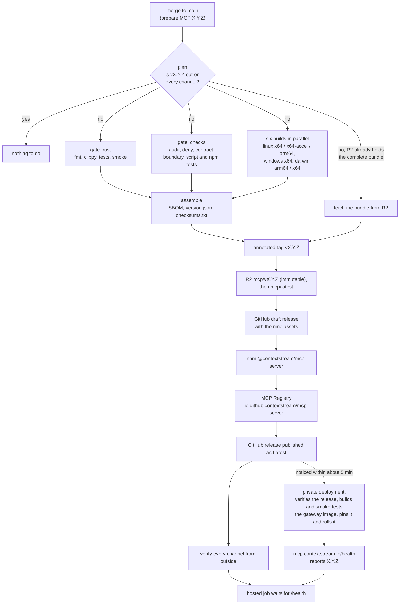

# Release process

Releases run end to end in Depot CI (`.depot/workflows/release.yml`) with no person in the loop. The logic lives in:

- `scripts/release/mcp_release.py`: plan, assemble, publish, verify, the hosted wait and the R2 probe;
- `scripts/release/gate.sh`: the gate;
- `scripts/release/build.sh`: the builds.

GitHub Actions does not run releases. The old `.github/workflows/release.yml` is kept only for its tests. A pushed
`v*` tag still starts an Actions run that never gets a runner; ignore it.

## Cutting a release

Merge a "prepare MCP X.Y.Z" change to `main`. It needs:

- the same stable version in `Cargo.toml`, `package.json` and `server.json`;
- a `## X.Y.Z` section in `CHANGELOG.md`, which becomes the GitHub release notes.

That push releases it. Nothing else is needed.



### Jobs

1. **plan** (2 CPUs, a few seconds) reads the version at the pushed commit and checks what every public channel
   holds for it: npm, the MCP Registry, the GitHub release, R2 `mcp/vX.Y.Z/` and `mcp/latest/`.
   - A version that is out everywhere ships nothing, so ordinary pushes cost one small job.
   - A version older than npm `latest` is refused.
   - If tag `vX.Y.Z` exists, the tag's commit is the release, whatever `main` holds since.
2. **gate** runs two parts side by side.
   - `rust` (32 CPUs): `cargo fmt --check`, clippy with `-D warnings`, `cargo test --workspace --all-targets`, the debug
     build and its account-connection smoke.
   - `checks` (8 CPUs): `cargo audit`, `cargo deny`, the release contract and version resolution, the public
     boundary, the `.github/scripts` and `scripts/release` tests, the adoption and grounding tests, and `npm test`.
   - Tools are pinned by sha256. Rust compiles go through sccache on Depot's cache. The toolchain and crates come from
     the `depot-run` setup cache.
3. **build** makes the six binaries in parallel, one runner each (16 CPUs).

   | Binary | How it is built | How it is checked |
   |---|---|---|
   | `linux-x64`, `linux-x64-remote-acceleration` | native on x86_64 | `--version` runs; glibc needed stays at 2.39 or below |
   | `linux-arm64` | native on an arm64 runner | `--version` runs; glibc needed stays at 2.39 or below |
   | `win-x64.exe` | cargo-xwin (MSVC CRT and SDK) | `--version` runs under Wine |
   | `darwin-arm64`, `darwin-x64` | cross-built (next section) | `mcp_release.py macho-check` |

   `macho-check` verifies:
   - the linked libraries: exactly CoreFoundation, CoreServices, SystemConfiguration, libSystem and libiconv;
   - the minimum macOS: 11.0 on arm64 and 10.12 on x64, Rust's defaults;
   - the code signature on arm64;
   - the version string.
4. **publish** (4 CPUs) assembles the bundle, then does the following in this order:
   1. Assembles the bundle with syft and the release contract: `sbom.spdx.json` (the crates in `Cargo.lock`, under `contextstream-mcp` and the release version), `version.json` and `checksums.txt`.
      Or, on a resume, fetches the bundle from R2.
   2. Pushes the annotated tag `vX.Y.Z`.
   3. Writes R2 `mcp/vX.Y.Z/`, with `version.json` last, then `mcp/latest/`. Every object is read back.
   4. Creates a GitHub draft with the nine assets and checks their sha256 digests.
   5. Publishes to npm with `--provenance=false`.
   6. Publishes to the MCP Registry: the GitHub token is exchanged for a registry token, which must grant
      `io.github.contextstream/*`, and `server.json` is posted as committed.
   7. Publishes the GitHub release as Latest.
   8. Checks every channel from outside:
      - npm `latest` and its integrity against `npm pack`;
      - a fresh `npm install` that downloads and runs the R2 binary;
      - `npm audit signatures`;
      - the registry entry is active and latest;
      - GitHub Latest and its asset digests;
      - all nine files under R2 `vX.Y.Z/` and `latest/`.
5. **hosted** waits up to 75 minutes for `https://mcp.contextstream.io/health` to report the version.
   - The private deployment notices the new GitHub Latest on its own, within about 5 minutes. It verifies the release
     identity, builds and smoke-tests the gateway image, pins it and rolls it.
   - This repository never dispatches a private deployment.

### The darwin cross-build

Depot CI has no macOS runners, so `build.sh` makes a macOS SDK root without Apple's SDK. It holds:

- the macOS libc headers and `libSystem.tbd` that Zig ships (no other part of Zig is used);
- the stubs in `scripts/release/macos-link-stubs` for the three frameworks and `libiconv`;
- the header shims in that directory's `include/`.

Ubuntu's clang compiles the C dependencies (jemalloc, aws-lc, ring) and ld64.lld links against that root. The
tool path is fixed, so the compile cache hits across runs.

The binaries import no symbol that 1.0.29's Mac-built ones did not, with no weak imports and the same libraries and
compatibility versions. The only difference is the SDK version recorded in the binary: 14.0, against 27.0 from the
Mac. If a dependency update needs a framework symbol that is not stubbed yet, the link fails; see the stubs'
README.

## Dry run

```
depot ci dispatch --repo contextstream/mcp-server --workflow release.yml --ref main --input mode=dry-run
```

It gates, builds and assembles the bundle, runs `npm publish --dry-run` and `mcp-publisher validate`, and publishes
nothing. Dispatched on `main`, it also proves the R2 key: it puts, lists, reads and deletes a probe object under
`mcp/.release-probe/` (`mcp_release.py r2-probe`). Any run that is not a clean checkout of `main` is a dry run,
whatever mode it asks for: a branch, or a laptop `depot ci run` with a patch.

## Re-running after a failure

Fix the cause, then dispatch the workflow again, or push to `main`. Nothing needs cleaning up first.

```
depot ci dispatch --repo contextstream/mcp-server --workflow release.yml --ref main --input mode=release
```

Every step skips what is already done with the same bytes, and stops at different bytes:

- **The tag** fixes the commit. Later commits on `main` are not released until the next version.
- **R2 `mcp/vX.Y.Z/` with its `version.json`** marks a complete bundle. A re-run builds nothing and publishes those
  bytes. The builds are not byte-reproducible, so this is what keeps a resume consistent.
  - Before `version.json` is written, a re-run may replace a partial upload. Once npm has the version it may not.
- **npm, the registry entry, GitHub assets and R2 objects** that already exist must match, or the run stops.
- **`mcp/latest/`** never moves to an older version.

A bad artifact that is already public is never replaced: fix forward with the next patch version.

## Secrets

These are Depot CI secrets. Each has one variant, `main-release`, limited to repository `contextstream/mcp-server`,
branch `main` and workflow `release.yml`. The publish step of a release gets them, and the R2 probe of a dry run on
`main` gets the three R2 ones. None is printed, written to a file or passed on a command line.

| Secret | Used for |
|---|---|
| `MCP_RELEASE_GITHUB_TOKEN` | Pushing the tag, the GitHub release and its assets, and the MCP Registry login. It must be an org Owner's token, because the registry grants `io.github.contextstream/*` only to Owners. |
| `MCP_RELEASE_NPM_TOKEN` | `npm publish` of `@contextstream/mcp-server`. It must publish without a one-time password: a granular token with "bypass 2FA" and write access to the package. |
| `MCP_RELEASE_R2_BUCKET_URL` | The S3 endpoint and bucket of the release bucket. |
| `MCP_RELEASE_R2_ACCESS_KEY_ID`, `MCP_RELEASE_R2_SECRET_ACCESS_KEY` | The S3 pair of an account-owned API token limited to object read and write on that one bucket. The access key id is the token id; the secret is the sha256 of the token. |

## Timings (MCP 1.0.30, 2026-10-26)

| Step | Time |
|---|---|
| plan | 3 s |
| gate | rust 2 min 28 s, checks 17 s, side by side |
| builds | linux x64 4 min 26 s, x64-accel 4 min 1 s, arm64 4 min 53 s, Windows 4 min 32 s; darwin 6 min 38 s (arm64) and 6 min 58 s (x64) cold, 3 min 38 s with the compile cache |
| tag | 1 s |
| R2 | 67 s, including the wait for the public route |
| GitHub draft with nine assets | 12 s |
| npm publish until readable | 86 s |
| MCP Registry | 2 s |
| GitHub Latest | 1 s |
| outside verification | 19 s |
| GitHub Latest to the gateway pin | 5 min 22 s |
| gateway pin to `/health` reporting the version | 15 min 37 s, including one retry of the deployment's own release |

- **Merge to every public channel:** about 11 minutes of pipeline time. The 1.0.30 run also waited 43 minutes for a
  new npm token, which is not counted here.
- **Merge to a live gateway:** about 32 minutes.
- **The manual process before:** 66 minutes (1.0.29) to every channel and about 90 minutes to the gateway, with an
  operator for the darwin builds, npm 2FA, the registry login and the gateway roll.

| Run | What it was |
|---|---|
| `ks5xr3bspx` | dry run |
| `ps_txqrkdgnph` | release; stopped at npm, old token |
| `w00vg143pt` | resume; every channel and the gateway |
| `gjcstzhj8c` | dry run with the R2 probe |
